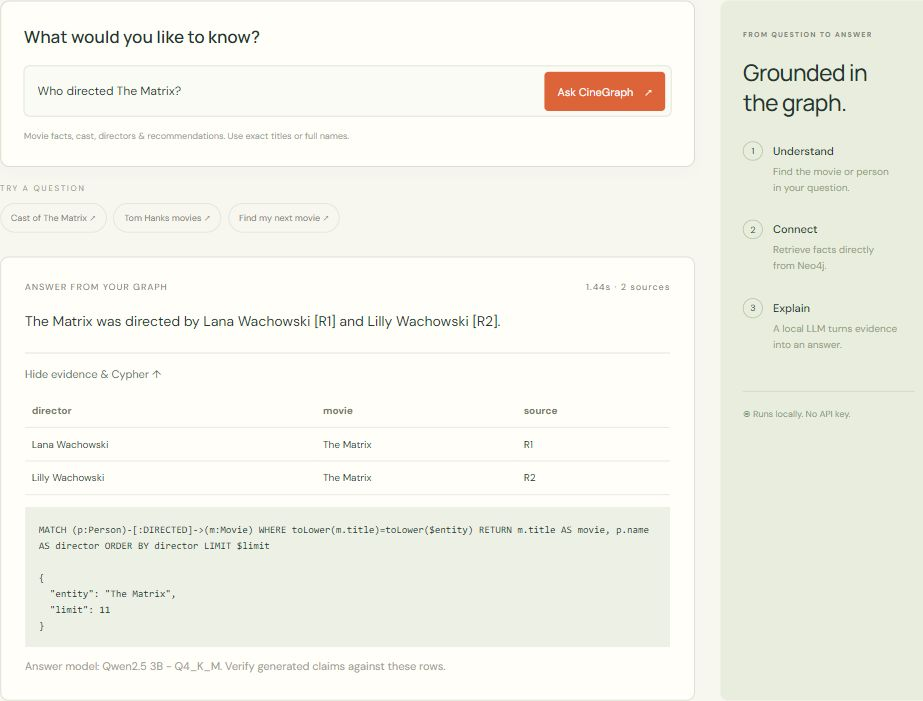

# CineGraph — Exercise 3

A working local movie Graph RAG website for Advanced NLP (AML23702), using the official Neo4j Movies graph, parameterized Cypher retrieval and a local Qwen model through llama.cpp.

**Student:** Aditi S Yaranal · **USN:** 1GA23AI003 · **Semester:** 7th · **Department:** AIML  
**Institution:** Global Academy of Technology · **Lab Exercise:** 3 · **Submission date:** 7 October 2026

[Final lab report](output/pdf/1GA23AI003_Exp3_Movie_Graph_RAG.pdf) · [Repository](https://github.com/Aditisy/Cinigraph)



## Open the finished website

**http://127.0.0.1:8765**

On this computer, double-click **Launch CineGraph.cmd** to start the database, LLM and website again. Services run in the background. First startup can take about a minute.

- **Ask CineGraph:** questions, generated answers, evidence and Cypher.
- **Movie collection:** search all 38 movies and select one to ask about it.
- **Knowledge graph:** visualize cast and director relationships.
- **About the project:** architecture, limitations and downloadable report.

## Questions to try

```text
Who directed The Matrix?
Who acted in The Matrix?
Movies with Tom Hanks
Movies directed by Nora Ephron
When was The Matrix released?
Tell me about Apollo 13
Recommend movies like The Matrix
```

Use an exact movie title or full person name; capitalization does not matter. The parser accepts these forms rather than arbitrary conversation. Unknown entities return no evidence; unsupported questions return a helpful error. Recommendations use shared actors, not ratings. Results are capped at 10 rows with a visible partial-list notice.

## Local runtime

| Component | Address / location |
|---|---|
| Website | http://127.0.0.1:8765 |
| Private Neo4j | bolt://127.0.0.1:7689 |
| Neo4j Browser | http://127.0.0.1:7479 |
| Local model server | http://127.0.0.1:8081 |
| Runtime and database | `.runtime/`, excluded from Git and source ZIP |
| Logs | `logs/` |

The launcher creates a private Neo4j password in `.runtime/password.txt`; do not publish it. The app reads it automatically. Services bind to loopback only. The original Ollama backend remains available with `config.example.json`; this website uses `config.local.example.json` and llama.cpp.

Stop this project's services with:

```powershell
powershell -NoProfile -ExecutionPolicy Bypass -File .\stop_local.ps1
```

## Reproduce on another Windows computer

Prerequisites: Python 3.10+ and a full Java 21 or 25 JDK. Allow several GB of disk space for model/runtime downloads. CPU inference speed depends on hardware. No paid API key, Docker or Neo4j Desktop account is needed.

```powershell
py -m venv .venv
.\.venv\Scripts\python.exe -m pip install -r requirements.txt
.\.venv\Scripts\python.exe setup_local.py
Copy-Item config.local.example.json config.json
powershell -NoProfile -ExecutionPolicy Bypass -File .\start_local.ps1
```

Setup downloads official portable runtimes, the Qwen GGUF model and the official movie import script. Vendor runtime license files are retained; see the model card for its license. The source ZIP excludes large runtimes and private credentials. Setup selects a current Windows llama.cpp CPU asset; `data/provenance.json` records the one used. The Neo4j version is fixed at 2026.09.0.

`initialize_graph.py` imports only into this project's dedicated database when it contains no movie nodes. It does not delete data. The delivered graph contains 38 movies, 133 people and 253 relationships.

## Verify

```powershell
.\.venv\Scripts\python.exe -m unittest discover -s tests -v
$env:NEO4J_PASSWORD = (Get-Content .runtime\password.txt -Raw).Trim()
.\.venv\Scripts\python.exe verify_database.py
.\.venv\Scripts\python.exe tests\live_evaluation.py
```

On this computer the launcher also supports the bundled Python and `.runtime/python` dependencies. Unit tests mock external services. `verify_database.py` runs against Neo4j; `tests/live_evaluation.py` uses the real website and LLM and saves `output/live_results.json`. Automated checks verify routing, evidence and successful generation, not every claim; inspect the answers and citations too.

## Deliverables

- `app.py`, `web_app.py`, `static/`: CLI, web API and responsive UI.
- `queries.json`, `cypher_templates.cypher`: six query templates.
- `data/`: official import script and provenance.
- Setup, initialization, launch and stop scripts.
- `output/pdf/Exercise_3_Report.pdf` and editable `REPORT.md`.
- `output/live_results.json`, `offline_test_results.txt` and verification scripts.

## Limits and troubleshooting

- Generated answers may still contain errors; check prose against retrieved rows. The educational graph is not a complete or authoritative film catalogue.
- If services are offline, rerun the launcher and inspect `logs/`. Check for port conflicts.
- A missing Java module generally indicates a stripped runtime; use a full supported JDK.
- LLM failures preserve evidence and are labelled explicitly.
- Flask is configured for local review. Public deployment needs a production server and access controls.

## Sources

- Supplied Lab Exercise with Rubrics (2).pdf: Exercise 3, page 2; rubric, pages 4–5.
- https://github.com/neo4j-graph-examples/movies
- https://neo4j.com/docs/python-manual/current/query-simple/
- https://neo4j.com/docs/operations-manual/current/installation/windows/
- https://github.com/ggml-org/llama.cpp
- https://huggingface.co/Qwen/Qwen2.5-3B-Instruct-GGUF

## Rebuild the report

The final report follows the supplied lab-report format, includes the student's details and a blank faculty evaluation sheet, and documents observed model limitations.

```powershell
python -m pip install -r requirements-report.txt
python scripts/build_submission_report.py
```

The report date is recorded explicitly in the builder for this submission. GitHub contains the source and report; the application runs locally and is not deployed by publishing the repository.
